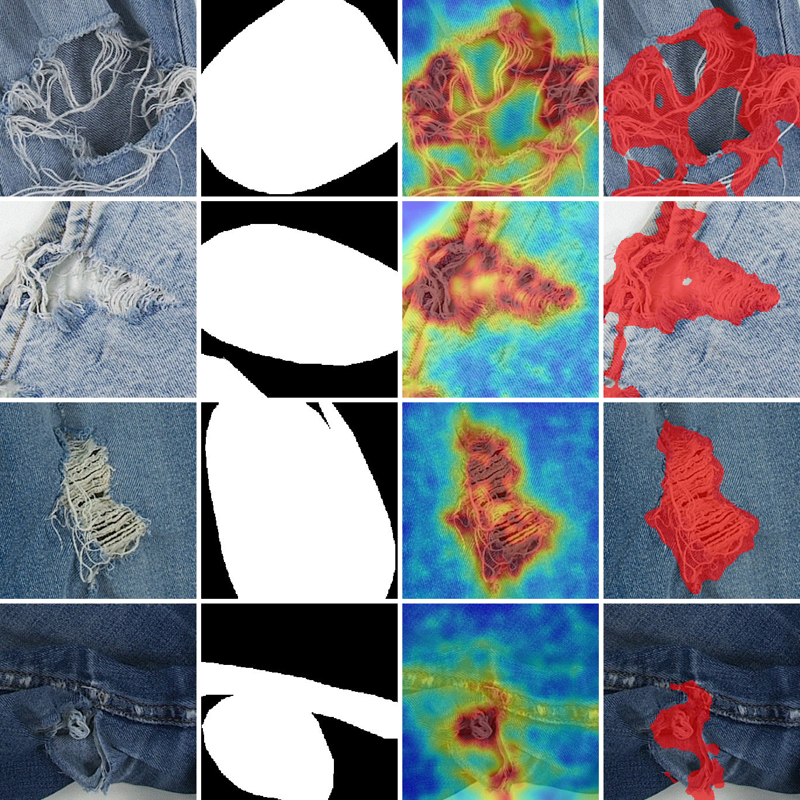

# Deep Learning for Sorting and Damage Detection in Second-Hand Garments

Code for my bachelor thesis at the Institute of Visual Computing, TU Graz.
We train PaDiM and Reverse Distillation (RD) only on defect-free patches of used garments
and test how well they find defects such as holes, stains and abrasion.
The experiments use the ReUseTex dataset (14 garment types, 6,807 images).

<p align="center">
  
</p>

*Reverse Distillation on jeans. Each row is one defect. From left to right: input patch, ground-truth mask, anomaly map, prediction (pixels above the 99th percentile of scores on good patches).*

## Setup

```bash
python3.12 -m venv .venv
source .venv/bin/activate
pip install -r requirements.txt
```

The dataset is not part of this repository. Place it (or a symlink to it) in the project root:

```
202603_ReUseTex_Setup1/
├── 01_data/            images + *_coco.json annotations
├── 02_segmentation/    garment masks (*_mask.png)
└── metadata.csv
```

All scripts are run from the project root.

## Repository structure

| Folder | Content |
|---|---|
| `final/` | **The pipeline behind all results in the thesis.** PaDiM and RD on 14 garment types with a garment-level 5-fold split, plus the zero-shot experiment. |
| `data_cleaning/`, `models/`, `analyze_hyperparams.py` | Scripts from the development phases before the final pipeline, see [Development history](#development-history). |

Only `final/` is maintained. The older scripts are kept to show how we got there.
Some of them use older paths or dataset folders and may need small changes to run.

## Running the final evaluation

```bash
python final/run_final.py --sub jeans --split 5fold      # one garment type
python final/run_zero_shot.py --sub t_shirt               # jeans models on t-shirts
```

To run all 14 types:

```bash
for sub in dress jacket_multi_layer jacket_single_layer jeans long_pants misc polo_shirt shorts skirt sportswear sweatshirt t_shirt; do
    python final/run_final.py --sub $sub --split 5fold
done
for sub in knit_wool shirt_blouse; do   # these two have no subcategory
    python final/run_final.py --sub $sub --field garment_main_category --split 5fold
done
```

Zero-shot needs the jeans models, so run `python final/run_final.py --sub jeans --split 80_20` first.
Each type needs about 5 GB of disk space. Details are in `final/README.md`.

## Results in this repository

For every garment type, `final/<type>/split_5fold/` and `split_80_20/` contain the settings
(`config.json`, `folds.json`), the result tables (`results/*.csv`) and the plots (`plots/`).
The zero-shot results are in `final/<type>/zero_shot_jeans/`.

## Development history

The final pipeline is the result of several rounds of trial and error.
The scripts of the earlier rounds are kept in the repository, even though the thesis does not use their numbers.

### Phase 0: first steps on MVTec AD

We first ran the anomalib models on the MVTec AD categories *leather* and *carpet*, which are the closest to textiles.
We also rotated these images by 90 degrees to test how well the models work when the texture is seen at a different angle.

| Script | Purpose |
|---|---|
| `models/patchcore.py`, `models/supersimplenet.py`, `models/reverse_distillation.py` | PatchCore, SuperSimpleNet and RD on leather and carpet |
| `models/*_rotated.py` | the same models on the rotated versions |
| `models/padim_mvtec_sanity_check.py` | PaDiM sanity check on MVTec AD |

### Phase 1: first jeans dataset and model choice

The first dataset was built from the jeans images only.
We segmented the garments with SAM3, cut them into a regular grid of 224 px patches and trained five models on it.
Two problems came up. PatchCore and PaDiM ran out of GPU memory, so we had to limit the number of training and test patches.
And because of the regular grid, a defect at a patch border was split over up to four patches, each with only a small part of it.

We therefore switched to *defect-centred* patches of 336 px. Each defect patch is centred on an annotated defect,
and the defect masks are shrunk (eroded) by 0, 20 or 45 px to remove the uncertain border of the annotation.
On this dataset, RD gave the best results. The erosion level changed the AUROC only a little,
but 45 px removed too many small defects: only 10 seam defect patches were left in the test set (51 without erosion),
and stain patches dropped from 282 to 163. With 20 px, most defects were kept and the masks were still cleaner.
This is why the final pipeline uses PaDiM and RD with 336 px patches and 20 px erosion.

| Script | Purpose |
|---|---|
| `data_cleaning/patch_pipeline.py` | SAM3 garment mask and grid patches for one image (first version) |
| `data_cleaning/batch_pipeline.py`, `data_cleaning/filter_and_run_pipeline.py` | run `patch_pipeline.py` on all jeans images; this also saves the SAM3 garment masks that the final pipeline still uses for jeans |
| `data_cleaning/build_mvtec_dataset.py` | grid-patch dataset in the MVTec folder layout for anomalib |
| `models/padim_ivc.py`, `models/patchcore_ivc.py`, `models/patchcore_sanity_check.py` | first runs on the grid-patch dataset, mostly to find out how many patches fit into GPU memory |
| `models/*_custom_ivc.py` | PaDiM, PatchCore, RD, SuperSimpleNet and EfficientAD on the grid-patch dataset |
| `analyze_hyperparams.py` | defect sizes and how many defects a patch size / defect threshold would keep |
| `data_cleaning/patch_pipeline_focused.py` | defect-centred patching for one image, to compare the three erosion levels visually |
| `data_cleaning/build_focused_dataset.py` | defect-centred dataset for all jeans images, with 0, 20 and 45 px erosion |
| `data_cleaning/generate_manifest.py` | CSV listing which image and position each patch of the focused dataset comes from |
| `models/run_focused_benchmark.py`, `models/run_patchcore_focused.py`, `models/run_focused_rd_ssn.py` | the four models on the three erosion levels |
| `models/inspect_failures.py` | per-defect recall and images of missed defects and false alarms |

### Phase 2: more garment types

Next, we trained PaDiM and RD on t-shirts and long pants, and applied the jeans models to them without retraining.
This phase showed three weaknesses of the setup.
The good patches were split randomly into training and test, so patches of the same garment could end up on both sides.
anomalib by default uses the test set as validation set, so the F1 thresholds were tuned on the test data.
And a single 80/20 split gave numbers that changed noticeably with the random seed.
The final pipeline fixes all three with a garment-level split, scores computed without anomalib's normalisation, and 5-fold cross-validation.

| Script | Purpose |
|---|---|
| `models/run_rd_padim_20px.py`, `models/run_rd_padim_tshirt_20px.py`, `models/run_rd_padim_long_pants_20px.py` | PaDiM and RD on jeans, t-shirt and long pants (results in `second_phase_rd_padim/<type>/results/`) |
| `models/run_tshirt_zero_shot.py`, `models/run_long_pants_zero_shot.py` | jeans models applied to t-shirt and long pants |
| `models/visualize_rd_padim_20px.py`, `models/inspect_failures_second_phase.py` | example images and failure analysis |

The jeans checkpoints of the phase 2 zero-shot runs no longer exist, so these runs cannot be repeated.
The zero-shot results in the thesis come from `final/run_zero_shot.py`.

### Phase 3: final evaluation

`final/` builds the patches of each garment type once, splits them by garment, trains PaDiM and RD per fold
and evaluates everything with the same metrics. See `final/README.md`.

## Notes

- For 400 of the 630 jeans images, the garment masks come from an earlier SAM3 run
  (`data_cleaning/patch_pipeline.py`) instead of `02_segmentation`.
  Without these cached masks, `run_final.py` uses `02_segmentation`, so the jeans patches and numbers can differ slightly.
- The patches are split by garment, so patches of the same garment are never in both training and test.
- Seed 42 is used everywhere.
